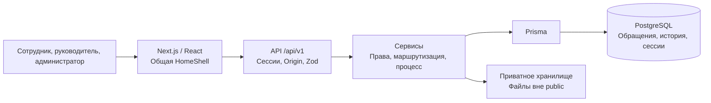

<div align="center">


# MODUS LINK

#### Система обращений и предложений сотрудников

**От обращения сотрудника — к ответственному, решению и понятному результату.**

Единый процесс обратной связи для ГК «Модус Трейд»:<br>
регистрация вопросов, маршрутизация, рассмотрение и история решений.

<br>


<br>

[Начало работы](#run)　·　[Возможности](#features)　·　[Архитектура](#architecture)　·　[Статус MVP](#status)

[Документация](#docs)　·　[Описание API](docs/api.md)　·　[Проверки](#testing)

</div>

---

> [!IMPORTANT]
> MODUS LINK — MVP для хакатона. Последний локальный прогон: typecheck, lint, **605 тестов** и production build прошли. Полная интеграционная и браузерная репетиция текущей версии ещё не завершена. Бейджи обозначают технологии и статус продукта, а не прохождение CI.

<details>
<summary><strong>Все разделы README</strong></summary>

- [О проекте](#about)
- [Какую проблему решаем](#problem)
- [Рабочий сценарий](#solution)
- [Возможности](#features)
- [Роли и доступ](#roles)
- [Технологии](#stack)
- [Архитектура](#architecture)
- [Интерфейс и скриншоты](#interface)
- [Быстрый старт на Windows](#run)
- [Тестирование](#testing)
- [Деплой](#deploy)
- [Документация](#docs)
- [Статус проекта и ограничения](#status)
- [Команда](#team)
- [Лицензия](#license)

</details>

<a id="about"></a>
## О проекте

MODUS LINK помогает сотрудникам сообщать о проблемах, предлагать улучшения и получать обратную связь о ходе рассмотрения. Руководителям система предоставляет очередь обращений, инструменты назначения и фиксации результата. Администраторы управляют пользователями, справочниками и правилами маршрутизации.

В основе — внутренний процесс компании. Клиентские опросы, NPS и корпоративные интеграции не входят в текущий MVP. Основание проекта — [техническое задание хакатона](docs/source/specification.txt), сохранённое в репозитории как текстовая копия проекта документа для согласования.

<a id="problem"></a>
## Какую проблему решаем

Когда предложения сотрудников распределены между переписками и устными договорённостями, возникают четыре сложности:

- **Обращения теряются:** нет единой точки регистрации и общей очереди.
- **Статус непрозрачен:** автору приходится отдельно выяснять, что происходит.
- **Ответственность размыта:** непонятно, кто должен рассмотреть вопрос.
- **Результат не сохраняется:** решения и причины отказов трудно найти и проанализировать.

Цель MODUS LINK — сделать этот процесс прослеживаемым. Снижение потерь обращений и экономию времени ещё предстоит измерить в пилоте; численные показатели эффективности не заявляются.

<a id="solution"></a>
## Рабочий сценарий

<p align="center">
  <strong>Сотрудник</strong>　→　<strong>Обращение</strong>　→　<strong>Маршрутизация</strong>　→　<strong>Руководитель</strong>　→　<strong>Решение</strong>　→　<strong>Результат</strong>
</p>

1. Сотрудник выбирает тип и категорию, описывает ситуацию и при необходимости прикладывает файлы.
2. Система сохраняет обращение в PostgreSQL, выдаёт номер и срок, выбирает исполнителя по правилам.
3. Руководитель рассматривает вопрос, комментирует, запрашивает уточнения и фиксирует решение.
4. Автор видит статус, результат и доступную ему историю изменений.
5. Данные обращений используются в аналитике с учётом прав пользователя.

Если подходящего правила нет, обращение сохраняется **без исполнителя** и остаётся в доступной очереди. Автоматическое назначение не считается ответом сотруднику.

<a id="features"></a>
## Возможности

| Направление | Что реализовано |
| --- | --- |
| Подача обращений | Проблемы, предложения и положительные отзывы; категория, тема, описание и приоритет; проверка обязательных полей |
| Реестр | Поиск, фильтры, сортировка, пагинация, выделение строк и экспорт CSV |
| Маршрутизация | Правила категории и подразделения; локальное правило приоритетнее глобального; ручное назначение допустимого исполнителя |
| Рассмотрение | Статусы и сроки, публичные комментарии, служебные заметки, запрос уточнения и ответ автора |
| Решения и история | Итоговое решение или причина отказа; история действий в транзакциях; архивирование и восстановление без удаления обращения |
| Вложения | До 10 файлов по 10 МиБ: PDF, DOCX, XLSX, JPG/JPEG и PNG; проверка формата и авторизованное скачивание |
| Аналитика | KPI, динамика, типы, категории, подразделения, сроки и результаты; периоды 7/30/90 дней или всё время; CSV по подразделениям |
| Администрирование | Создание и редактирование сотрудников, роли, право общей аналитики, категории, подразделения и маршрутизация |
| Личный кабинет | Профиль, уведомления по публичной истории доступных обращений, справка и база знаний |
| Оформление | Общая HomeShell, светлая и тёмная темы с сохранением выбора, адаптивные страницы |

Основные статусы: **Новое → На рассмотрении → В работе → Реализовано / Отклонено → Закрыто**. Процесс также поддерживает уточнение; допустимые переходы повторно проверяются сервером.

<a id="roles"></a>
## Роли и доступ

| Системная роль | Просмотр | Действия |
| --- | --- | --- |
| `EMPLOYEE` — сотрудник | Собственные обращения, их публичные комментарии, результат и история | Создание, разрешённая правка нового обращения, ответы на уточнения, вложения |
| `MANAGER` — руководитель | Собственные обращения, обращения своего подразделения и назначенные ему | Обработка доступных чужих обращений, статусы, решения, комментарии и назначения в рамках полномочий |
| `ADMIN` — администратор | Все обращения и административные разделы | Управление пользователями, справочниками и правилами; обработка чужих обращений |

**`canViewCompanyAnalytics` — дополнительное право, а не четвёртая системная роль.** Оно разрешает агрегаты всей компании, но не открывает чужие карточки и не даёт административных действий. ADMIN получает общую аналитику по роли.

Права проверяются на сервере. Автор не может обрабатывать собственное обращение, даже если он MANAGER или ADMIN. Служебные комментарии доступны обработчикам и скрыты от автора. Выбор кабинета на экране входа не назначает роль.

<a id="run"></a>
## Быстрый старт на Windows

### Требования

- Node.js **22.12+**, npm и Git.
- PowerShell; используйте `npm.cmd`, если запуск `npm.ps1` ограничен политикой системы.
- PostgreSQL: Docker Desktop с Linux-контейнерами, существующий сервер или локальный embedded-postgres.
- Свободный порт **3001** для приложения и выбранный порт PostgreSQL. Порт **3100** нужен только для отдельного тестового приложения.

### Первоначальная установка в новой копии

```powershell
git clone https://github.com/MIKARASO-MIKA-MIYA/modus-link.git
Set-Location modus-link
npm.cmd ci

if (-not (Test-Path -LiteralPath .env)) {
    Copy-Item -LiteralPath .env.example -Destination .env
}
```

До запуска отредактируйте локальный `.env`. Замените примерные учётные данные собственными, не публикуйте содержимое файла. Для обычной установки отключите демонстрационный seed: `DEMO_SEED_ENABLED=false`.

<details>
<summary><strong>Переменные окружения</strong></summary>

| Переменная | Назначение |
| --- | --- |
| `DATABASE_URL` | Приватная строка подключения к выбранному PostgreSQL: пользователь, пароль, адрес, порт и имя БД |
| `APP_ORIGIN` | Для штатного локального запуска — `http://127.0.0.1:3001` |
| `SESSION_TTL_HOURS` | Срок серверной сессии; по умолчанию 12 часов |
| `COOKIE_SECURE` | Для локального HTTP — false; в production Secure включается принудительно |
| `ATTACHMENT_STORAGE_DIR` | Приватный каталог файлов; по умолчанию `.storage/attachments` |
| `POSTGRES_PASSWORD` | Для Compose: выбранный пароль БД, согласованный с паролем в DATABASE_URL |
| `DEMO_SEED_ENABLED`, `DEMO_PASSWORD` | Только для отдельно подготовленной синтетической демонстрации |

Если пароль содержит специальные символы, их нужно корректно закодировать в URL. Полные строки подключения и пароли в README намеренно не приводятся.

</details>

**Выберите один способ запуска PostgreSQL.**

#### Вариант A — Docker Compose

Для новой локальной установки подготовьте согласованные `POSTGRES_PASSWORD` и `DATABASE_URL` в `.env`. Сервис из [compose.yaml](compose.yaml) использует пользователя `modus`, базу `modus_pulse` и адрес `127.0.0.1:5432`.

```powershell
docker compose up -d db
docker compose ps db
```

Дождитесь состояния healthy. Данные сохраняются в volume. При повторном запуске существующего volume изменение переменной пароля не меняет пароль уже созданной БД. Не используйте `down -v` для обычной остановки.

<details>
<summary>Вариант B — embedded-postgres без Docker</summary>

Используйте только для осознанной первоначальной подготовки локального кластера. Задайте в `.env` локальный DATABASE_URL с выбранными учётными данными и портом, например **55432**, чтобы отделить его от стандартного 5432.

```powershell
npm.cmd run db:local
```

[Скрипт](scripts/local-postgres.ts) запускает настоящий PostgreSQL из установленной зависимости, слушает только 127.0.0.1 и хранит кластер в `.postgres/data`. Он **инициализирует кластер при отсутствии PG_VERSION** и создаёт указанную БД, если её нет. Это команда подготовки, а не безопасная проверка состояния неизвестной существующей БД.

Оставьте терминал работающим, приложение запускайте во втором. На Windows библиотека использует принудительное завершение процесса при остановке; для управления существующим кластером предпочтителен штатный `pg_ctl`, описанный ниже.

</details>

#### Prisma и запуск приложения

Следующие команды подготовки схемы предназначены для **выбранной новой локальной БД**. Перед ними ещё раз проверьте DATABASE_URL.

```powershell
npm.cmd run db:generate
npm.cmd run db:migrate
npm.cmd run dev
```

`db:migrate` выполняет `prisma migrate deploy`, а не reset. Каждую миграцию следует просматривать перед применением к базе с данными. Миграция `default_categories` добавляет отсутствующие категории без импорта демонстрационных пользователей и обращений.

Откройте **http://127.0.0.1:3001**. Проверка соединения приложения с БД:

```powershell
Invoke-RestMethod -Uri 'http://127.0.0.1:3001/api/v1/health'
```

Ожидается `data.status = ok`, `data.database = connected`. HTTP 200 главной страницы сам по себе не подтверждает подключение PostgreSQL.

<details>
<summary><strong>Повторный запуск существующей базы и штатная остановка PostgreSQL</strong></summary>

**Не копируйте .env заново, не запускайте seed и не инициализируйте кластер повторно.** Сохраняйте прежние учётные данные, каталог и порт.

- Для существующего Compose-volume: `docker compose up -d db`.
- Для службы или внешнего сервера: используйте штатный способ управления именно этим экземпляром.
- Для существующего embedded-кластера на Windows x64 проверьте его через поставляемый `pg_ctl`:

```powershell
$clusterPath = Join-Path (Get-Location) '.postgres\data'
$pgCtlPath = Join-Path (Get-Location) 'node_modules\@embedded-postgres\windows-x64\native\bin\pg_ctl.exe'

if (-not (Test-Path -LiteralPath (Join-Path $clusterPath 'PG_VERSION'))) {
    throw 'Существующий кластер не найден. Автоматическая инициализация запрещена.'
}

& $pgCtlPath status -D $clusterPath
```

**Только если этот сервер остановлен**, запустите его с прежними параметрами. Ниже — вариант для локального порта 55432; он должен совпадать с вашей сохранённой конфигурацией:

```powershell
$pgLogPath = Join-Path (Get-Location) '.postgres\local-postgresql.log'
& $pgCtlPath start -D $clusterPath -l $pgLogPath -o '-p 55432 -h 127.0.0.1' -w
```

Не запускайте второй процесс поверх работающего кластера и не удаляйте вручную postmaster.pid. После обновления зависимостей/схемы при необходимости выполните `npm.cmd run db:generate`; миграции существующей БД рассматриваются отдельно. Обычный старт приложения:

```powershell
npm.cmd run dev
```

Завершайте PostgreSQL только когда он не нужен другим локальным процессам:

```powershell
& $pgCtlPath stop -D $clusterPath -m fast -w
```

Не используйте принудительное завершение для обычной остановки. Совместный безопасный launcher приложения и PostgreSQL пока не реализован.

</details>

<details>
<summary><strong>Вход, демонстрационные роли и настройка Origin</strong></summary>

### Вход и демонстрационные роли

На экране входа выберите «Создать аккаунт». Регистрация не требует почты: ник 3–32 символа, пароль 12–256 символов и подтверждение. Новый аккаунт получает EMPLOYEE; роли и право общей аналитики назначает администратор. После выхода используйте тот же ник и пароль.

Новый сотрудник попадает в подразделение **«Новые сотрудники»**. Для демонстрации автоматического назначения нужно заранее настроить подходящее правило; правило другого подразделения на него автоматически не распространяется.

Для отдельной свежей демонстрационной БД можно **один раз** подготовить синтетические данные: задать собственный DEMO_PASSWORD длиной не менее 12 символов и DEMO_SEED_ENABLED=true, проверить целевую БД, затем выполнить:

```powershell
npm.cmd run db:seed
```

После подготовки отключите разрешение seed. Не запускайте его в основной рабочей или production-БД.

| Синтетический аккаунт | Системная роль |
| --- | --- |
| `employee` | EMPLOYEE |
| `manager` | MANAGER |
| `admin` | ADMIN |
| `owner` | MANAGER + canViewCompanyAnalytics |

Выбранный DEMO_PASSWORD хранится только в локальном окружении и здесь не приводится. Seed не служит инструментом смены паролей существующих пользователей. Даты, история и показатели синтетического набора не являются статистикой компании.

### Origin и адрес приложения

APP_ORIGIN учитывает протокол и порт. В development для настроенного loopback-адреса разрешены localhost и 127.0.0.1 с тем же протоколом/портом. Их cookie различаются; при смене hostname потребуется вход заново. **Порт не изолирует cookie одного hostname:** тестовый браузер должен использовать отдельный профиль.

</details>

<a id="stack"></a>
## Технологии

Версии зависимостей подтверждены [package-lock.json](package-lock.json); допустимые диапазоны и команды — [package.json](package.json).

| Слой | Технологии | Подтверждённая версия |
| --- | --- | --- |
| Приложение и API | Next.js, App Router, Route Handlers | 16.4.6 |
| Интерфейс | React / React DOM | 19.3.1 |
| Язык | TypeScript | 5.9.3 |
| Доступ к данным | Prisma Client и PostgreSQL-адаптер | 7.10.1 |
| База данных | PostgreSQL | 18.6 в проверенном локальном кластере; Compose использует образ `postgres:18` |
| Валидация | Zod | 4.6.7 |
| Тесты | Vitest / jsdom | 4.1.12 / 26.1.0 |
| Статический анализ | ESLint | 9.39.5 |

Node.js: **от 22.12**, локальные проверки выполнены на **24.22.1**. Оформление построено на CSS-токенах; диаграммы — SVG-компоненты. Новая UI-библиотека для унификации не использовалась.

<a id="architecture"></a>
## Архитектура



- **Интерфейс** обращается к существующему HTTP API; данные не подменяются числами из макета.
- **API и сервисы** проверяют сессию, входные данные, область доступа и допустимость действия.
- **PostgreSQL** хранит реестр, пользователей, правила, комментарии и историю. Изменения обращения связаны с историей транзакциями; поле `version` защищает от конкурирующей записи.
- **Вложения** скачиваются только после проверки доступа к карточке. Текущий адаптер хранит файлы на диске сервера.
- **Авторизация** использует серверные сессии, HttpOnly/SameSite cookie, проверку Origin и хеширование паролей scrypt. В production cookie всегда Secure.

<details>
<summary><strong>Структура репозитория</strong></summary>

| Каталог | Назначение |
| --- | --- |
| `src/app` | Страницы, API-маршруты и стили |
| `src/components` | HomeShell, формы, таблицы, диалоги и графики |
| `src/server` | HTTP-обработчики, авторизация, права, сервисы и маршрутизация |
| `src/lib` | Клиент API, Prisma и общие функции |
| `prisma` | Схема, SQL-миграции и синтетические данные |
| `tests` | Модульные, компонентные и интеграционные проверки |
| `docs` | ТЗ, архитектура, API, аудиты и ограничения |

</details>

<a id="interface"></a>
## Интерфейс и скриншоты

Единый визуальный стандарт: Sidebar **#0A1427**, светло-серый фон, белые скруглённые карточки и красные акценты. Все внутренние страницы используют одну HomeShell и общий Header; поддерживаются светлая и тёмная темы.

| Основной экран | Маршрут | Назначение |
| --- | --- | --- |
| Dashboard | `/` | Сводка, динамика, распределение статусов и последние обращения |
| Мои обращения / Все обращения | `/tickets` | Реестр с поиском, фильтрами и действиями |
| Карточка обращения | `/tickets/[id]` | Детали, обсуждение, история, вложения и обработка |
| Аналитика | `/analytics` | Показатели и распределения в разрешённой области |

**Актуальных скриншотов этих страниц в репозитории пока нет.** Старые макеты и изображения логотипа не выдаются за снимки работающего интерфейса. Полный перечень 13 существующих страниц — в [аудите унификации](docs/interface-unification.md).

<a id="testing"></a>
## Тестирование

Обычные проверки проекта:

```powershell
npm.cmd run typecheck
npm.cmd run lint
npm.cmd test
npm.cmd run build
```

Последний подтверждённый локальный прогон — **13 ноября 2026**:

| Проверка | Результат |
| --- | --- |
| TypeScript | Успешно |
| ESLint | Успешно |
| Vitest | **605 тестов, 27 файлов — успешно** |
| Production build | Успешно, включая генерацию Prisma Client |
| PostgreSQL / health | Соединение и SELECT 1 подтверждены; health возвращал HTTP 200 |

Это локальные результаты, **не статус CI и не подтверждение production deployment**. build не проверяет полноту миграций или пользовательский сценарий с БД.

| Уровень проверки | Текущий статус |
| --- | --- |
| **A. Модульные, компонентные и контрактные тесты** | Пройдены. Используют чистые функции, fixtures и подменённые API/Prisma |
| **B. Настоящий HTTP API + изолированный PostgreSQL** | Suite существует; полный актуальный прогон ещё не выполнен |
| **C. Настоящий браузер** | Сквозной сценарий текущей версии и полная визуальная проверка остаются открытыми |

<details>
<summary><strong>Интеграционные проверки и безопасное тестовое окружение</strong></summary>

Команда интеграционного runner существует:

```powershell
npm.cmd run test:integration
```

**Это не команда для основной БД.** Runner может создать *_test БД, автоматически применяет миграции, выполняет seed; suite содержит очистку тестового LoginThrottle. Перед запуском требуется подтверждённая изоляция и согласованный порядок подготовки. Суффикс имени базы сам по себе не гарантирует безопасность.

Локально уже проверено ограничение отдельной непривилегированной роли через HBA к новой тестовой БД. Она пока пуста, а runtime-роль намеренно не имеет административных прав для штатного runner. Существующую старую тестовую БД с данными повторно использовать не следует. Подробности и границы выполненного — в [отчёте интеграционной подготовки](docs/INTEGRATION_VERIFICATION.md).

Дополнительная команда `npm.cmd run smoke` выполняет входы и изменяет сессии/счётчики авторизации: её нельзя считать полностью read-only проверкой.

</details>

<a id="deploy"></a>
## Деплой

Для Vercel необходим PostgreSQL, доступный из окружения хостинга. Локальный адрес 127.0.0.1 туда не переносится. Секретный DATABASE_URL задаётся в переменных окружения проекта; для Preview нужна отдельная БД.

В [vercel.json](vercel.json) задана существующая команда:

```text
npm run db:migrate && npm run build
```

Она применяет ожидающие миграции **до сборки**. Перед публикацией требуется проверить целевую БД, SQL миграций и резервное копирование. Демонстрационный seed в production запускать не нужно.

Приложение разрешает точные HTTPS-адреса из VERCEL_URL, VERCEL_BRANCH_URL и VERCEL_PROJECT_PRODUCTION_URL при VERCEL=1. В настройках Vercel должен быть включён доступ к [системным переменным окружения](https://vercel.com/docs/environment-variables/system-environment-variables). Для дополнительного собственного домена задайте APP_ORIGIN; вне Vercel production требует APP_ORIGIN. Произвольные поддомены не разрешаются. В production cookie всегда Secure.

> **Вложения требуют отдельного решения для Vercel.** Текущий адаптер записывает файлы в приватный каталог диска. Файловая система Vercel Functions доступна только для чтения, кроме временного /tmp; постоянное хранение вложений в .storage этим не обеспечивается. Нужны внешнее постоянное хранилище и интеграция с ним, которых сейчас нет. См. [ограничения файловой системы Vercel](https://vercel.com/docs/functions/runtimes#file-system-support).

Успешная локальная сборка не означает готовность промышленного размещения. HTTPS-авторизацию, облачную БД, миграции и файлы нужно проверять на конкретном deployment.

<a id="docs"></a>
## Документация

| Документ | Содержание |
| --- | --- |
| [Техническое задание](docs/source/specification.txt) | Бизнес-контекст и ожидаемые результаты хакатона |
| [Архитектура](docs/architecture.md) | Компоненты, права и жизненный цикл |
| [API](docs/api.md) | Маршруты, запросы и ответы |
| [База данных](docs/database.md) | Схема, происхождение синтетических данных, вложения |
| [Подключение интерфейса](docs/frontend-integration.md) | Контракты frontend и API |
| [Объём и ограничения MVP](docs/mvp-scope.md) | Реализованные функции, допущения и дальнейшее развитие |
| [Унификация интерфейса](docs/interface-unification.md) | Все страницы, общая оболочка и пределы визуальной проверки |
| [Финальный аудит MVP](docs/FINAL_MVP_AUDIT.md) | Соответствие ТЗ, риски и ручной чек-лист |
| [Изоляция тестовой PostgreSQL](docs/INTEGRATION_VERIFICATION.md) | Актуальные результаты подготовки интеграционного окружения |
| [История технических проверок](docs/verification.md) | Результаты прошлых этапов; даты и версии имеют значение |

Документы аудита отражают состояние на момент проверки. Обнаруженная ранее недоступность локального PostgreSQL устранена; исторический аудит не следует читать как текущий мониторинг.

<a id="status"></a>
## Статус проекта и ограничения

**MODUS LINK — MVP для хакатона, с реализованным процессом обработки обращений и незавершённой сквозной верификацией.**

Перед демонстрацией остаётся пройти полный сценарий на изолированной БД и в браузере: создание → назначение → уточнение → решение → результат автора → аналитика.

Текущие ограничения:

- Уведомления работают внутри приложения по публичной истории; нет гарантированной мгновенной доставки, почты и push.
- Селекторы части справочников ограничены первыми 100 записями.
- У обращений есть version, у правил маршрутизации контроля версий нет; известные риски конкуренции описаны в аудите.
- Нет серверной идемпотентности создания при потере ответа POST. После подтверждённого создания форма повторяет только неуспешные вложения.
- Аналитический период фильтрует обращения **по дате создания**. «Первая реакция» не обязательно означает текстовый ответ; сроки 2/5/10 календарных суток — демонстрационное правило.
- Dashboard исключает отклонённые исходы из «Завершено», а аналитика и реестр включают их: показатели нужно сравнивать с учётом формул.
- Нет SSO, интеграций 1С/Битрикс24, антивируса вложений и автоматического поиска смысловых дублей.
- Масштабирование, восстановление из резервных копий и пригодность для production требуют отдельной проверки.

<a id="team"></a>
## Команда

Подтверждённый состав команды и распределение ролей участников в репозитории пока не опубликованы.

Разработка ведётся в [репозитории MODUS LINK](https://github.com/MIKARASO-MIKA-MIYA/modus-link).

<a id="license"></a>
## Лицензия

Файл лицензии проекта в репозитории отсутствует. Лицензия в этом README не заявляется.

---

<p align="center">
  <a href="#run">Начало работы</a>　·　<a href="docs/api.md">API</a>　·　<a href="docs/architecture.md">Архитектура</a>　·　<a href="docs/mvp-scope.md">Границы MVP</a>
</p>
