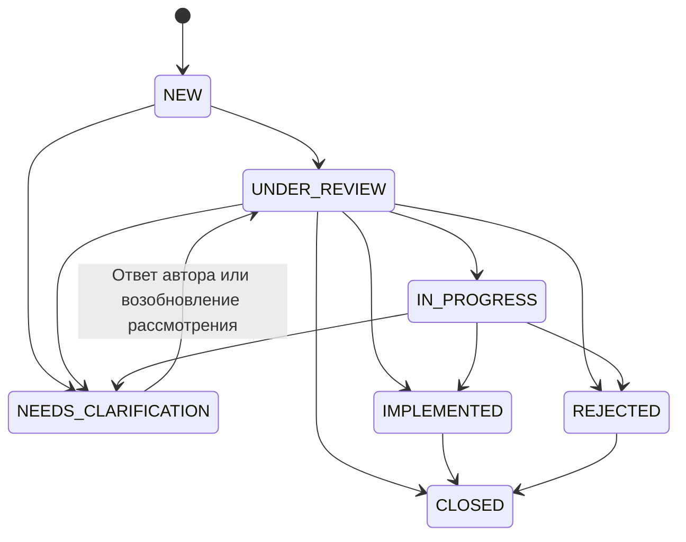

# Архитектура MODUS LINK

Приоритет — единый сохраняемый процесс от регистрации до решения. API и бизнес-логика не зависят от React и будущего дизайна Canva. Приложение Next.js App Router работает в Node.js runtime; Prisma обращается к PostgreSQL через @prisma/adapter-pg. Версии фиксирует package-lock.json. Выбран стабильный Prisma 7, без перехода на Prisma 8 release candidate.

## Границы компонентов

| Компонент | Ответственность |
| --- | --- |
| src/app/api/v1/**/route.ts | Тонкие экспорты HTTP-обработчиков, Node runtime, запрет кэширования |
| src/server/handlers.ts, http.ts | Разбор HTTP, единые ответы, Origin, ошибки, ограничение тела |
| src/server/auth | Проверка scrypt, случайные сессии, хеши токенов, cookie |
| src/server/validators | Строгие Zod-схемы входных данных |
| src/server/permissions | Ограничение SQL-выборок и полномочий на операции |
| src/server/repositories | Фильтры и выборки, безопасные проекции пользователей |
| src/server/services | Транзакции обращений, аналитика, административная логика |
| src/server/routing | Выбор маршрута без AI |
| src/types | Клиентские DTO и доменные перечисления без Prisma runtime |
| prisma | Схема, версионируемые SQL-миграции, повторяемый seed |
| tests | Vitest unit и интеграционные проверки настоящего API |

## Доступ

EMPLOYEE читает только свои обращения, включая архив. MANAGER читает свои, обращения своего подразделения и назначенные ему. ADMIN читает все. Все проверки выполняются в сервисах и SQL-ограничениях выборки. Недоступная карточка возвращает 404, включая history/comments; интерфейс не служит границей безопасности.

Обрабатывать обращение может ADMIN либо MANAGER своего подразделения/назначенный ему, при условии что он не автор. Даже администратор не принимает решение по своему обращению. Менеджер назначает активных MANAGER/ADMIN только в пределах своего подразделения и только для обращения этого подразделения. Межотдельное переназначение выполняет ADMIN. Ответственный из другого подразделения может рассматривать назначенное ему обращение. Пользователь EMPLOYEE не назначается обработчиком в этом MVP.

`canViewCompanyAnalytics` — независимое право чтения агрегатов компании. Его выдаёт только ADMIN. Собственник имеет MANAGER + это право: общая панель доступна в том же приложении, а доступ к содержимому чужих карточек автоматически не расширяется. ADMIN имеет общую аналитику по роли. Остальные видят показатели по той же выборке, что и доступный реестр. Уполномоченный руководитель может получить это право без административной роли.

Внутренние комментарии и соответствующие события истории видны обработчикам; автор видит PUBLIC даже при собственной роли MANAGER/ADMIN. Решения и изменения статуса всегда публичны для автора.

## Жизненный цикл

NEEDS_CLARIFICATION требует публичный вопрос. Публичный ответ автора автоматически переводит обращение в UNDER_REVIEW; комментарий и обе записи истории сохраняются в одной транзакции. REJECTED требует свежую причину в запросе. IMPLEMENTED/CLOSED требуют итог: при переводе уже реализованного/отклонённого в CLOSED разрешено сохранить прежний результат. `outcome` сохраняет первоначальный исход при последующем CLOSED, чтобы аналитика не теряла реализованные улучшения и отказы. Повторное открытие завершённого обращения отложено; создаётся связанное по тексту новое обращение.

## Защита от потери

Номер выдаёт PostgreSQL sequence, независимо от бизнес-логики и параллельных запросов. Пропуски номеров после отката допустимы, повторов нет. A-001—A-020 сохранены для источника; новые номера MP-00000001 и далее.

Категория + подразделение имеют преимущество перед глобальным правилом категории. Учитываются только активные обработчики, отличные от автора; неработающее правило не мешает регистрации. Правила с совпадающей активной областью запрещены уникальными частичными индексами. Если подходящего правила нет, обращение получает assigneeId=null, обязательный dueAt, статус NEW и событие о поступлении в очередь. GET /tickets?unassigned=true показывает такую очередь с обычным ограничением доступа. Автоматическое назначение не считается ответом сотруднику.

Все изменения обращения, комментарии, назначения и архивирование сохраняются с историей атомарно. Клиент передаёт `version`; UPDATE ... WHERE version = запрошенная увеличивает её. Проигравшее одновременное изменение возвращает 409 и откатывает все события. Автор редактирует только заголовок/описание NEW; обработчик может изменить приоритет и срок открытого обращения. Изменения сроков фиксируют старое и новое значение.

Архивировать можно только IMPLEMENTED, REJECTED, CLOSED с результатом. Архив не меняет исход, не удаляет историю и не скрывает карточку от автора. API удаления отсутствует; PostgreSQL запрещает DELETE Ticket и UPDATE/DELETE истории и комментариев. Пользователь с полномочиями владельца БД технически может изменить защитные триггеры: для промышленной среды нужны отдельные административная и runtime-роли БД и организационные процедуры доступа.

## Сроки и уведомления

HIGH — 2, MEDIUM — 5, LOW — 10 календарных суток от создания, без праздничного календаря. Это демонстрационное допущение, а не регламент компании. dueAt обязателен, может меняться обработчиком с историей. Просрочено = dueAt < текущее время и статус не завершённый. Время идёт и в ожидании уточнения. Реестр содержит фильтры NEW, unassigned, overdue; внешние уведомления и фоновые эскалации отложены.

## Аутентификация

Scrypt со случайной 16-байтной солью; в БД нет открытых паролей. Сессия — 32 случайных байта в HttpOnly SameSite=Lax cookie, в БД только SHA-256 токена и срок (по умолчанию 12 часов). Сервер читает актуальную роль и активность пользователя при каждом запросе. В production cookie всегда Secure, нужен HTTPS. Вход ротирует текущую сессию; выход удаляет её на сервере. Администратор при изменении пользователя отзывает все его сессии. Публичной регистрации и самоназначения ADMIN нет.

Изменяющие запросы, включая login и register, требуют точного Origin из APP_ORIGIN. Тело JSON ограничено 64 KiB, строки и пагинация имеют границы. Ограничители входа и регистрации хранятся в PostgreSQL: максимум 15 попыток на операцию и нормализованный ник за 15 минут (для прежнего входа по email — на email). IP не берётся из недоверенных X-Forwarded-For. Для промышленного периметра дополнительно нужен сетевой rate limit; он не имитируется в MVP.

Конфигурация и API Prisma 7 проверены по [официальному руководству](https://www.prisma.io/docs/guides/upgrade-prisma-orm/v7); async params и Route Handlers — по [документации Next.js](https://nextjs.org/docs/app/guides/upgrading/version-16). Бизнес-допущения проекта зафиксированы выше.
## Реализованный интерфейс

App Router-страницы используют общий AppFrame, role-aware навигацию, независимые клиентские DTO, fetch-обёртку и useResource с отменой устаревших запросов. Общие UI-компоненты отделены от серверных сервисов. Используется общая таблица, реальные SVG-диаграммы, доступные диалоги и адаптивные стили. Переходы статусов экспортируются из чистого src/types/workflow.ts и повторно проверяются сервисом; клиент не заменяет серверную авторизацию.

Вложения обслуживаются отдельным локальным приватным адаптером в server/services/attachments.ts. Чтение проходит через getTicket; загрузка проверяет версию, увеличивает её и фиксирует ATTACHMENT_ADDED. Runtime-файлы исключены из tracing production-сборки; резервная копия .storage — отдельная задача эксплуатации.

Уведомления в приложении основаны на PUBLIC истории; внешний транспорт не используется. Интеграционные тесты запускают отдельные БД, каталог Next .next-integration и хранилище .storage/test-attachments, а после завершения восстанавливают вспомогательные TypeScript-конфиги Next. Это позволяет проверять API, пока основной интерфейс работает локально.
